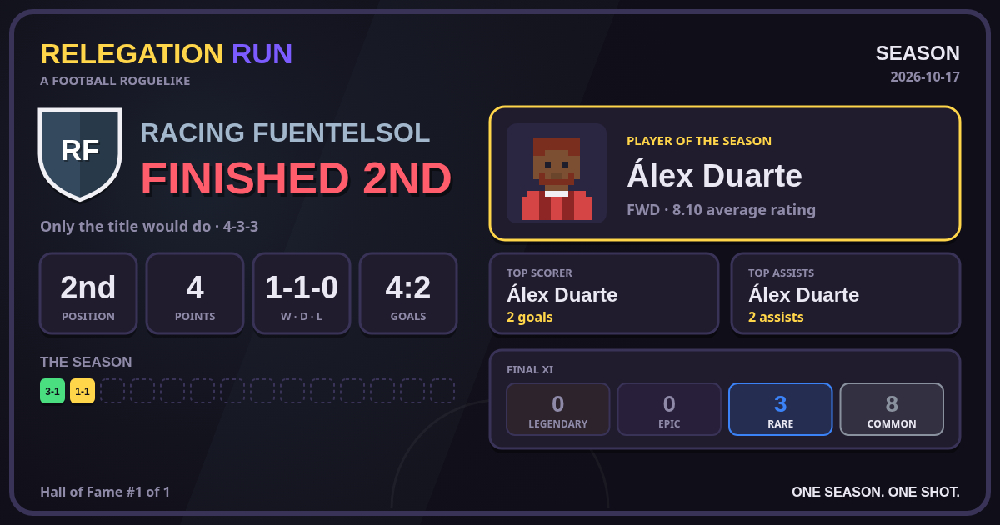
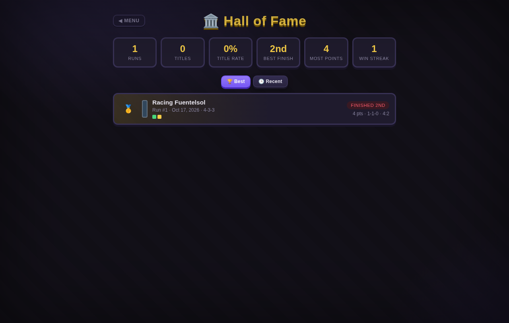

<div align="center">

# ⚽ Relegation Run

**a football management roguelike**

*One season. One shot. Win the league — or vanish.*

[](LICENSE)


[Play](#-quick-start) · [How to play](#-how-to-play) · [Features](#-features) · [Architecture](#-architecture) · [Tests](#-testing) · [Contributing](#-contributing)

</div>

---

Relegation Run is a browser game that mixes squad management with deck-building roguelike runs. Your squad is a hand of procedurally generated player cards. Each run is one season in a fictional 8-team league. You pick the XI, set tactics, haggle in the transfer market and watch every match played out by a continuous 22-player simulation. Win the league and you're a legend. Lose three in a row and the board shows you the door.

Everything is procedural: teams, players, opponents' tactics, portraits and sound. The game has **no dependencies, no build step and no network requests**. Open `index.html` and play, even offline.

## 🚀 Quick start

```bash
git clone <this-repo> relegation-run
cd relegation-run
# either open index.html directly in your browser (file:// works), or:
python3 -m http.server 8000   # then visit http://localhost:8000
```

On phones and tablets the interface switches to a touch layout with bottom navigation. You can force it on desktop with `?mobile=1`.

**Requirements:** any modern browser (Chrome, Firefox, Safari, Edge). Phaser 3.80.1 ships in `lib/`, so nothing is fetched from a CDN.

## 🎮 How to play

| | |
|---|---|
| 🏆 **Goal** | Win an 8-team league over 14 matchdays (a double round-robin). |
| 💀 **Game over** | Three defeats in a row, or finishing anywhere but first. |
| 🔥 **Boss matches** | Matchdays 5, 10 and 14: buffed opponents, guaranteed high-rarity loot. |

**A matchday loop:**

1. **Manage.** Pick your XI on the pitch, rest tired players, sign or sell cards in the shop and hire staff.
2. **Plan.** Choose one of 7 formations and set mentality, pressing, passing style and width. The scout report breaks down the opponent's shape and plan, so you can counter it.
3. **Play.** Watch the match at x1/x2/x4 or skip it. At half-time, the tactics board lets you change mentality and pressing.
4. **Reap.** Collect gold for results and objectives, pick a reward card and check the full match stats.

At the end of the season (or when you're sacked) you get a **season review**. It shows a results strip for every matchday, the season's awards (player of the season, top scorer, top assists, league top scorer), stats for every player in your squad and the final table.

### Season card and Hall of Fame

Every finished run, title or sacking, gets a **season card**: a 1200×630 image (the size link previews and most feeds expect) with your club crest, the verdict, position, points, W-D-L, goals, a colour-coded square for every matchday (boss matches outlined, unplayed ones dashed), your player of the season with their pixel portrait, the top scorer and assist maker, the rarity mix of your final XI and any new personal records.



- **📤 Share card** opens your device's share sheet with the PNG where the browser supports it (most phones). Elsewhere it saves the PNG and copies the text summary.
- **⬇️ Save PNG** downloads the image.
- **📋 Copy text** copies a short summary that pastes cleanly anywhere:

```
Relegation Run #12 · 👑 Champions
Athletic Northport · 1st · 34 pts
🟩🟩🟨🟩🟥🟩🟩🟩🟨🟩🟩🟩🟩🟩
11W 2D 1L · 31-12
🏅 Leo Marsh (7.84)
```

Every run is also carved into the **🏛️ Hall of Fame**, reachable from the main menu and the end screen. It shows career totals (runs, titles, title rate, best finish, most points, best win streak) and lists up to 20 runs, sorted by **Best** (titles first, then final position, points, goal difference and goals) or **Recent**. Tap any run to reopen and share its card. New records (first title, best finish, most points, most goals, longest win streak) are flagged on the end screen and printed on the card.



*Both screenshots come from the automated browser check, which ends a run after two matchdays, so most of the season strip is empty.*

### Saving

The game **autosaves** after every management action and as soon as a match ends. Close the tab at any time and use **Continue** on the main menu to pick the run back up. Results are locked in when the final whistle goes: reloading never replays a match. If you reload on the post-match screen, the unclaimed reward card is lost. Starting a new run while a save exists asks for confirmation first. All data stays in your browser's `localStorage`.

## ✨ Features

| System | Details |
|---|---|
| **Attributes** | 33 attributes on a 1-20 scale in four groups (Technical, Mental, Physical, Goalkeeping), rolled from position profiles and rarity. Every player has a full colour-coded profile. |
| **Player cards** | Position, rarity (Common / Rare / Epic / Legendary), age, a synergy tag, 0-2 passive skills (Clutch, Brick Wall, Killer, Engine, Captain, Speedster, Shot Stopper, Sniper, Battler, Star) and season stats. |
| **Formations** | 4-3-3, 4-4-2, 4-2-3-1, 3-5-2, 3-4-3, 5-3-2 and 4-1-4-1, with per-slot roles (wing-back, holding midfielder, attacking midfielder, winger…). **Cohesion** grows the more you play a shape. |
| **Tactical clash** | Every AI club has its own XI, formation and game plan. The scout report analyses the matchup: overloads by zone, pressing and space to exploit. |
| **Match engine** | Continuous 2D simulation on a 105×68 m pitch. 22 agents hold formation anchors that shift with the ball. It covers passes with error and interceptions, dribbles, tackles, fouls, cards, suspensions, penalties, corners, throw-ins, aerial duels, saves and rebounds, live fatigue and player ratings. The same engine drives the visible match, the skip button and every AI-vs-AI fixture. |
| **Synergies** | Four tags (Academy, Superstar, Physical, Technical) with thresholds that grant team-wide attribute bonuses. This is the game's deck-building multiplier. |
| **Staff** | 8 staff cards (Scout, Physio, Agent, Benefactor, Tactician, Motivator, Talent Spotter, Economist). You can hire up to 3. |
| **Economy** | Gold from wins, objectives and sales. Wages are paid every matchday. The shop has rerolls, and transfers are negotiated with an AI that has hidden patience and a hidden reserve price. |
| **Fitness, form, morale** | Playing drains condition according to Stamina, and tired players perform worse and get injured more. Form follows match ratings, and morale follows results. |
| **Season review** | Results strip, awards, per-player stats and the final table. |
| **Season card & Hall of Fame** | Shareable 1200×630 PNG card drawn on a canvas (Web Share API, download or clipboard text) and a ranked, persistent history of every run with personal records. |
| **Save / resume** | Versioned autosave in `localStorage` with validation and anti-replay. |
| **Presentation** | Phaser renders the match (striped pitch, ball flight with shadow and trail, animated cards, celebrations, live HUD). Portraits are deterministic procedural pixel art and the sound is synthesised with WebAudio, so the game ships no binary assets. |
| **Mobile** | App-style bottom navigation, swipeable bench, bottom-sheet modals and touch steppers. |

## 🏗 Architecture

Plain ES5 modules on the global scope, loaded in order by `index.html`. The **simulation is fully decoupled from rendering**: `Engine.MatchEngine.step(dt)` advances the match whether it's being drawn by Phaser, skipped, or simulated headless for the rest of the matchday — which is also what makes the Node tests possible.

```
index.html          Screens and layout (+ mobile detection)
css/style.css       Dark, chunky card-game UI (tweens, rarity glow, 3D flips)
css/mobile.css      Touch layer: bottom nav, bottom sheets, larger targets
js/attrs.js         33 attributes: position profiles, ratings, summaries
js/formations.js    Formations with slots/roles, tactics, matchup analysis
js/sprite.js        Procedural pixel-art portraits (canvas)
js/gen.js           Procedural generation: cards, AI squads, league, staff
js/synergy.js       Synergies, skills, form and morale → effective attributes
js/engine.js        Continuous match engine (spatial, headless or visual)
js/state.js         Run state, tactics, cohesion, line-up, meta, save/resume
js/league.js        Table, AI fixtures, top scorers, end of run, season review
js/hall.js          Hall of Fame: run entries, ranking, records, storage
js/card.js          Season card: canvas drawing, share text, Web Share / PNG / clipboard
js/economy.js       Shop, wages, rewards, injuries, condition
js/nego.js          Negotiation AI
js/ui.js            DOM rendering: management, tactics, profiles, post-match, review
js/match.js         Phaser match renderer, HUD, half-time board
js/mobile.js        Restructures the UI for touch
js/main.js          Run flow: menu → manage → match → post-match → next / end
js/audio.js         WebAudio sound synthesis (no assets)
lib/phaser.min.js   Phaser 3.80.1 (MIT, see lib/LICENSE-phaser.txt)
tests/              Dependency-free Node and headless-Chrome tests
```

> Internal identifiers keep their original Spanish names (`plantilla` = squad, `jornada` = matchday, `alineacion` = line-up). All comments and every player-facing string are in English.

**Persistence** (`localStorage`):

| Key | Contents |
|---|---|
| `relegation-run:save` | `{ version, savedAt, phase, idSeq, run }`. The single autosave slot. `phase` is `manage` or `post`. The save is ignored if the version or shape doesn't match. |
| `relegation-run:hall` | `{ version, entries }`. The Hall of Fame: one self-contained snapshot per finished run (team, verdict, record, results strip, award winners), enough to redraw its card. It keeps up to 20 runs and trims from the bottom of the ranking, never the run just played. Invalid data is ignored. |
| `relegation-run:meta` | Lifetime record: runs, titles, best finish, best winning tally. The legacy key `rm_meta` is migrated automatically. |

## 🧪 Testing

No dependencies, just Node 18+.

```bash
node tests/smoke.js 100     # plays 100 full seasons with random decisions and checks invariants
node tests/save.js          # save/resume and season-review tests (simulated page reloads)
node tests/hall.js          # Hall of Fame ranking/records/storage and season-card layout tests
node --experimental-websocket tests/browser-check.js [chrome-path] [?mobile=1]
                            # opens index.html in headless Chrome over file://, plays two matches,
                            # checks the season card canvas and the Hall of Fame,
                            # fails on any console error or warning
```

`tests/harness.js` boots the real game modules in a Node VM with a minimal fake DOM. Passing the same storage to a second boot simulates a page refresh.

## 🗺 Roadmap

- Difficulty balancing from real play sessions (gold curve, rarity weights, opponent growth).
- A safeguard for the rare case where injuries and sales leave no playable formation and no gold.
- Keyboard navigation everywhere (the season card and profile modals already close with `Esc`).
- Testing on real Safari/iOS and Firefox devices.
- Multi-season careers and unlockables between runs.

## 🤝 Contributing

Issues and pull requests are welcome. Before opening a PR:

1. Keep it dependency-free and build-free: the game must still run from `file://`.
2. Keep the engine render-agnostic. Simulation logic goes in `engine.js`, drawing in `match.js`.
3. Run `node tests/smoke.js 50`, `node tests/save.js` and `node tests/hall.js`, plus the browser check if you touched UI or rendering.
4. If you change the shape of the run state, bump `SAVE_VERSION` in `js/state.js`.
5. Write code comments and UI text in English.

## 📄 License

[MIT](LICENSE) © 2026 imelero-dev.
Bundled [Phaser](https://github.com/phaserjs/phaser) is MIT-licensed by Phaser Studio Inc. (see [`lib/LICENSE-phaser.txt`](lib/LICENSE-phaser.txt)).

All clubs and players are fictional and procedurally generated. Relegation Run is not affiliated with any real league, club, player or commercial game.

## 🙏 Credits

- Built with [Phaser 3](https://phaser.io).
- Design nods to deck-building roguelikes (runs, rarities, synergy multipliers) and to classic football management sims (deep attributes, tactics, scouting).
