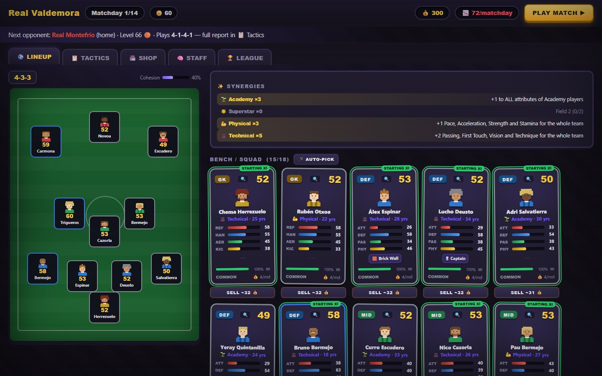
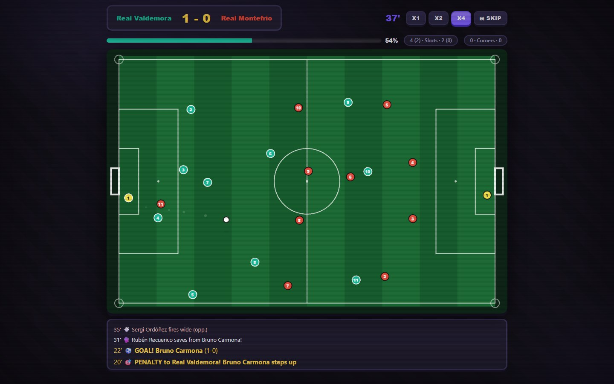
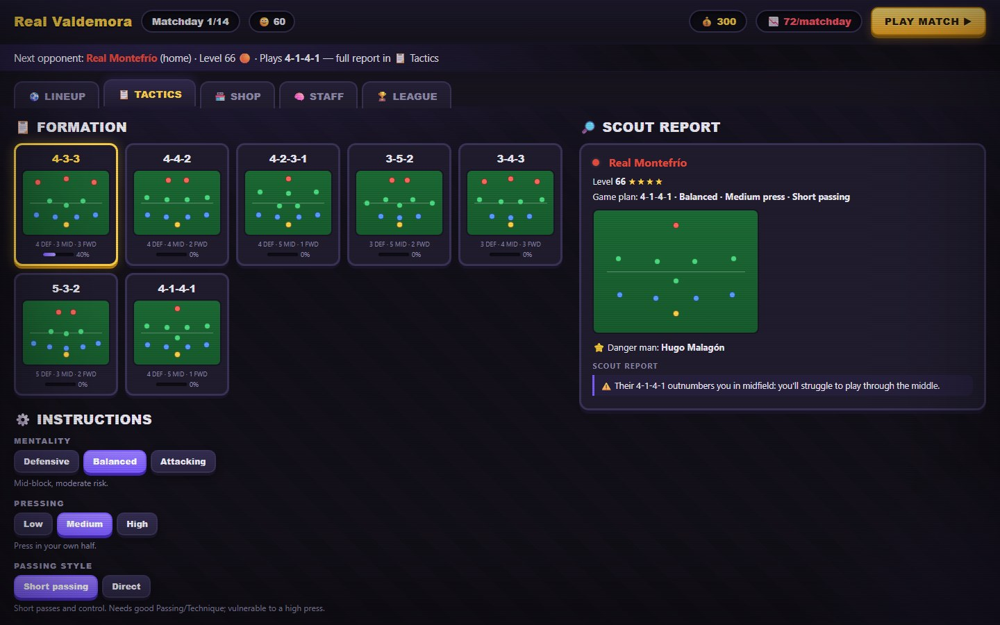
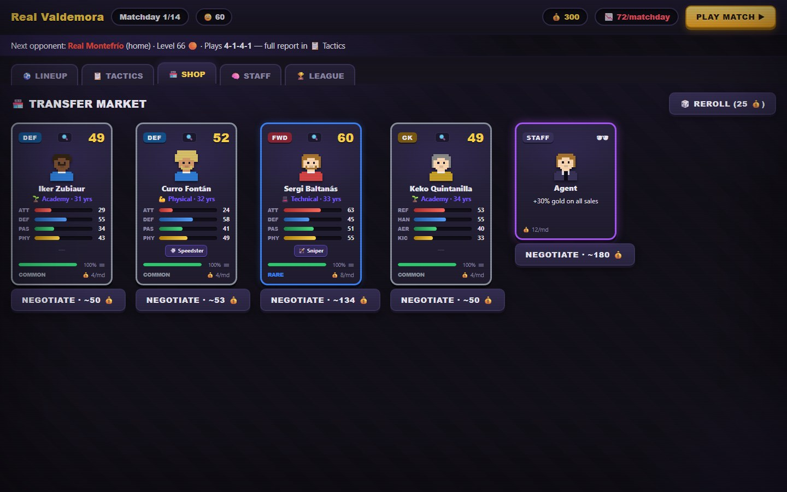
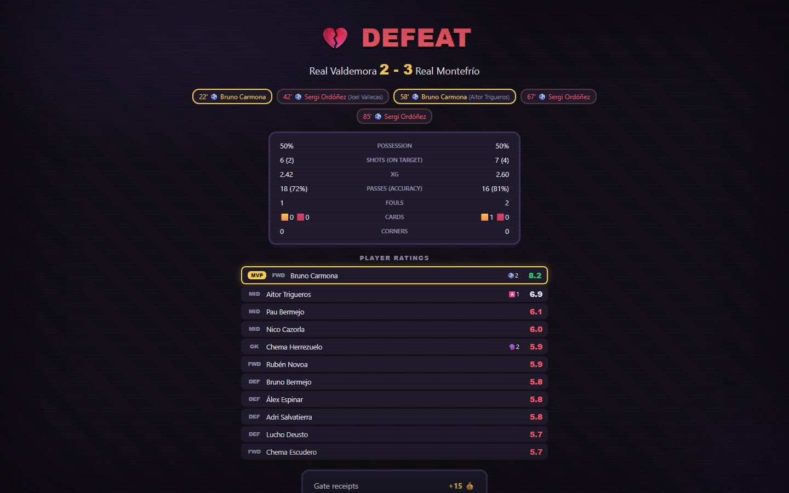
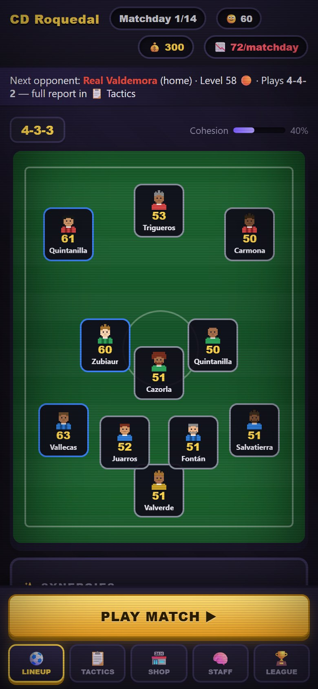

# Relegation Run

A football-management roguelike for the browser: deep squad management and tactics combined with deck-building roguelike runs, synergies and card drafting. Every team, player, card and rival tactic is generated procedurally.

The game has no dependencies, no build step and makes no network requests. It runs from `file://` and offline.



## How a run works

- **One run = one season**: 14 matchdays in an 8-team league of fictional clubs (double round-robin).
- **Win** by finishing as league champion. **Lose** after 3 straight defeats or by ending the season without the title.
- **Boss matches** on matchdays 5, 10 and 14: a boosted rival and guaranteed high-rarity loot.
- Between matches you set the lineup and tactics, buy and sell players, hire staff, and read the scouting report on the next rival.
- The run ends with a **season review**: a result for every matchday, awards (player of the season, top scorer, top assists, league top scorer), stats for the whole squad and the final table.

<table>
  <tr>
    <td></td>
    <td></td>
  </tr>
  <tr>
    <td></td>
    <td></td>
  </tr>
</table>

## Saving

The game autosaves to `localStorage` after every management action and as soon as a match ends. Use **Continue** on the main menu to resume. Results are locked at the final whistle, so reloading never replays a match; reloading on the post-match screen forfeits the unclaimed reward card. **New Run** asks before overwriting a save, and the save is deleted when the run ends.

| Key | Contents |
|---|---|
| `relegation-run:save` | The single autosave slot (versioned; invalid or outdated saves are ignored) |
| `relegation-run:meta` | Lifetime records: runs, titles, best finish. The legacy `rm_meta` key is migrated automatically |

## Systems

| System | What it does |
|---|---|
| Attributes | 33 attributes on a 1–20 scale (Technical, Mental, Physical, Goalkeeping), generated from position profile and rarity |
| Player cards | Position (GK / DEF / MID / FWD), rarity (Common / Rare / Epic / Legendary), age, a synergy tag and 0–2 passive abilities |
| Formations | 7 formations with per-slot roles. Cohesion with a formation grows the more you play it |
| Instructions | Mentality, pressing, passing style and width. Mentality and pressing can change at half-time |
| Tactical matchup | Each AI rival has its own XI, formation and game plan. The scout report flags zone overloads and weaknesses to exploit |
| Match engine | Continuous spatial simulation on a 105×68 pitch with 22 agents: passes and interceptions driven by attributes, dribbles, tackles, fouls, cards, set pieces, headers, rebounds, live fatigue and player ratings |
| Visual match | Phaser renders the engine state with a live HUD and x1 / x2 / x4 / skip controls |
| Availability | Red cards and injuries are served on the following matchdays; suspended or injured players can't be fielded |
| Condition and form | Playing drains condition (based on Stamina), which lowers performance and raises injury risk. Form follows ratings; morale follows results |
| Synergies | 4 tags (Academy, Superstar, Physical, Technical) with thresholds that grant team-wide attribute bonuses: the deck-building multiplier |
| Staff | 8 staff cards with passive effects, up to 3 at a time |
| Economy | Gold from wins, objectives and sales; wages per matchday; a shop with rerolls; AI negotiation with hidden patience and reserve price |
| League | Table, fixtures with each rival's formation, and top scorers. The other matches each matchday run on the same engine |
| Portraits | Deterministic procedural pixel-art faces drawn on canvas, no image assets |
| Sound | Synthesized with WebAudio, no audio files |

The engine is independent of rendering: `Engine.MatchEngine.step(dt)` drives the visible match, the skip button and the instant AI-vs-AI results.

## Mobile



On touch devices the UI switches to an app-style layout: bottom navigation bar, swipeable bench, bottom-sheet modals and larger touch targets. Force it on or off with `?mobile=1` / `?mobile=0`.

<br clear="right">

## Quick start

Open `index.html` in a browser (`file://` works), or serve the folder:

```bash
python3 -m http.server
# then open http://localhost:8000
```

Phaser 3.80.1 is bundled in `lib/`; nothing is loaded from a CDN.

## Tests

Node 20+, nothing to install (`package.json` only holds script shortcuts).

```bash
npm test               # 20 simulated seasons (invariants, no deadlocks) + save/resume tests
npm run test:browser   # headless Chrome over file://: plays two matches, reloads, resumes,
                       # renders the season review; fails on any console error or warning
npm run test:browser -- "<path-to-chrome>" "?mobile=1"   # custom Chrome path, touch layout
```

`tests/harness.js` boots the real game modules in a Node VM with a minimal fake DOM; reusing the same storage simulates a page reload.

## Tech stack

Vanilla JavaScript, HTML and CSS, with [Phaser 3](https://phaser.io/) for the match view.

## Project structure

```
index.html         Screens and layout (+ mobile detection)
css/style.css      Dark card-game UI (tweens, rarity glow, 3D card flip)
css/mobile.css     Mobile layer: bottom bar, bottom sheets, touch targets
js/attrs.js        33 attributes: profiles, averages, summaries
js/formations.js   Formations with slots/roles, instructions, matchup analysis
js/sprite.js       Procedural pixel-art portraits (canvas)
js/gen.js          Procedural generation (cards, AI squads, league, staff)
js/synergy.js      Synergies, abilities, form and morale → effective attributes
js/engine.js       Continuous match engine (spatial, headless or visual)
js/state.js        Run state, tactics, cohesion, lineup, meta records, save/resume
js/league.js       Table, AI-vs-AI matchdays, top scorers, end of run, season review
js/economy.js      Shop, wages, rewards, injuries, condition
js/nego.js         Negotiation AI
js/ui.js           DOM rendering: squad, tactics, player sheet, post-match, league, review
js/match.js        Phaser match renderer, HUD and half-time board
js/mobile.js       Touch UI restructuring (bottom nav, steppers)
js/main.js         Run flow
js/audio.js        WebAudio sound effects
lib/phaser.min.js  Phaser 3.80.1 (MIT, see lib/LICENSE-phaser.txt)
tests/             Node and headless-Chrome tests
```

Internal identifiers keep their original Spanish names (`plantilla` = squad, `jornada` = matchday, `alineacion` = lineup); comments and all player-facing text are in English.

## Status

Playable prototype. Open items: difficulty balancing from real play, a rare no-playable-XI deadlock after injuries and sales, keyboard accessibility, and testing on Safari/iOS and Firefox.

## License

[MIT](LICENSE). Bundled Phaser is MIT-licensed by Phaser Studio Inc. (see [`lib/LICENSE-phaser.txt`](lib/LICENSE-phaser.txt)). All clubs and players are fictional and procedurally generated.
